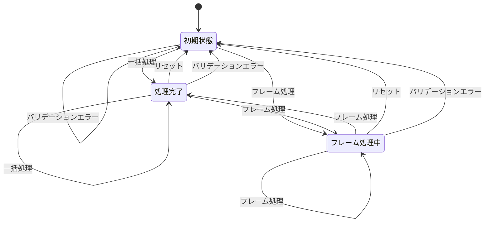
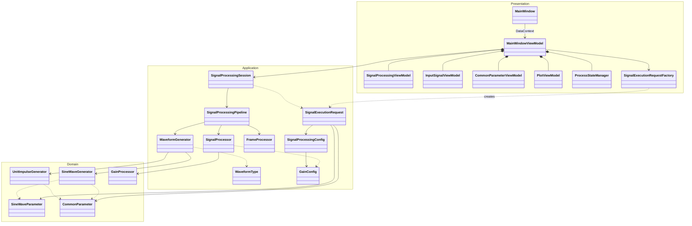

## 1. 開発環境
### .NET
- 10.0
### GUIフレームワーク
- WPF
### DIコンテナ
- Microsoft.Extensions.DependencyInjection 11.0.0
- コンポジションルートは App.xaml.cs（OnStartup で ConfigureServices により登録）
- Singleton で各 Application/Domain/Presentation サービスを登録し、コンストラクタインジェクションで解決
### NuGet
- commuittyToolkitMVVM
- XUnit
- Scottplot
## 2. コーディング規約
- フィールドはアンダーバーにキャメルケース
- ローカル変数はキャメルケース
- プロパティ、関数名、定数はパスカルケース
- マジックナンバーは禁止
- 変数名の省略は禁止（例：viewmodelをvm、indexをidxなど）
- 関数の引数は1個ずつ改行して宣言
## 3. レイヤ分け
### Presentation（src\SignalProcessingToolApp\Presentations）
- Views：View（xaml）、code-behind
- ViewModels：MainWindowViewModel、SubViewModels（InputSignal／CommonParameter／SignalProcessing／Plot）
- States：AppState、ProcessStateManager（状態遷移・UI有効状態の管理）
- Factories：SignalExecutionRequestFactory（UI値からリクエストを生成）
### Application（src\SignalProcessingToolApp\Applications）
- Sessions：SignalProcessingSession（一括・フレーム単位の処理実行、波形蓄積）
- Pipelines：SignalProcessingPipeline、WaveformGenerator、SignalProcessor、FrameProcessor、WaveformType
- Configs：SignalProcessingConfig、GainConfig
- DTOs：SignalExecutionRequest
### Domain（src\SignalProcessingToolApp\Domains）
- WaveformGeneration：SineWaveGenerator、UnitImpulseGenerator、SineWaveParameter
- SignalProcessing：GainProcessor
- Parameters：CommonParameter

## 4. UI
### 方針
- 画面を2列に分割。
- 0列：パラメータ入力（4行セクション）
- 1列：ボタンとグラフ

### 左列（パラメータ入力）
#### 0行：共通パラメータ
- サンプリング周波数 [Hz]
  - コンボボックス
  - 値は 44100、48000、96000 Hz
- フレームサイズ [Sample]
  - コンボボックス
  - 値は 8、16、32、64、128、256 sample
- データサイズ [Sample]
  - コンボボックス
  - 値は 8、16、32、64、128、256、512、1024 sample

#### 1行：入力信号
- 左列は Grid で2行1列に分割
  - 0行：ラジオボタン「正弦波」（Grid 0行0列）と正弦波周波数パラメータ（Grid 0行1列）
    - 正弦波周波数 [Hz]（コンボボックス）
    - 値は 100、200、500、1000、2000、5000、10000、20000 Hz
    - インパルス選択時は非活性
  - 1行：ラジオボタン「インパルス」（Grid 1行0列）のみ配置

#### 2行：信号処理
- ゲイン
  - チェックボックス「ゲインを適用」
  - チェック時のみ以下が有効
    - ゲイン値 [dB]（コンボボックス）
    - 値は 0、-3、-6、-9、-12、-15、-18、-200 dB
  - チェック未時は入力信号がそのまま出力

### 右列（グラフとボタン）
#### 0行：操作ボタンとステータス
- ボタンの配置順：「フレーム処理」「一括処理」「リセット」
- **フレーム処理中の非活性化**：
  - 左列パラメータ入力（共通パラメータ、入力信号、信号処理）をすべて非活性にする
  - 一括処理ボタンを非活性にする
  - フレーム処理ボタンのみアクティブ（連続フレーム処理が可能）
  - リセットボタンは常にアクティブ
- ステータス表示：リセットボタンの右側に配置
  - 「今どの状態であるか」のみを表示
  - 例：「準備完了」「処理完了」「フレーム処理中」
  - 初期状態：グラフに何もプロットされていない状態を示す
  - リセットボタン押下またはバリデーションエラー時：初期状態に戻す

#### 1行：入力信号グラフ
- 正弦波またはインパルスを表示
- X軸：[0, データサイズ-1]
- Y軸：[-1.2, 1.2]

#### 2行：処理後グラフ
- ゲイン適用済みの波形、またはゲイン未適用時は入力信号のまま
- X軸：[0, データサイズ-1]
- Y軸：[-1.2, 1.2]

## 5. バリデーション
### プレゼンテーション層
- ユーザー入力については、プレゼンテーション層で数値以外の入力が入った場合は例外をスロー。

### ドメイン層
#### 1. 共通パラメータ
- サンプリング周波数、フレームサイズ、データサイズ、負の値なら例外をスロー。
- フレームサイズがデータサイズより大きい場合は例外をスロー。

#### 2. 正弦波のパラメータ
- 正弦波の周波数がサンプリング周波数から算出されるナイキスト周波数以上なら例外をスロー。

#### 3. 信号処理のパラメータ
- (現時点ではゲインのみ。ディレイは仕様追加後に対応。)

## 6. エラー処理
### 表示方法
- **エラーメッセージ**：メッセージボックスで表示
  - ユーザーに即座に通知される
  - 確認ボタンで閉じると初期状態に戻す
- **ステータス表示**：状態表示のみに特化
  - エラーメッセージは表示しない
  - 「準備完了」「処理完了」など、現在の状態を示す

## 7. グラフの初期状態と更新ルール
- リセットボタン押下時
  - グラフをクリア（何もプロットされない状態）
  - ステータス：「準備完了」
- 初期状態でパラメータを変更した場合
  - フレーム処理または一括処理ボタンを押下しない場合、グラフは自動更新されず、プロットされない状態を保持する
  - ステータス：「準備完了」（パラメータ変更後も変わらない）
  - フレーム処理または一括処理を押下した時点で初めてグラフが更新される
- バリデーションエラー時
  - グラフをクリア（何もプロットされない状態）
  - メッセージボックスでエラー内容を表示
  - ステータス：「準備完了」
  - ユーザーがメッセージボックスを閉じると初期状態に戻す
- フレーム処理時のグラフプロット
  - **リセット状態**: 蓄積配列は Null（何もプロットされない）
  - **フレーム処理 1 回目**: 蓄積配列を新規作成（サイズ = データサイズ）、インデックス 0～（フレームサイズ-1）にデータを書き込み、全蓄積データ（0～フレームサイズ分）をプロット
  - **フレーム処理 2 回目**: 蓄積配列に追記、インデックス フレームサイズ～（2×フレームサイズ-1）にデータを書き込み、全蓄積データ（0～2×フレームサイズ分）をプロット
  - **繰り返し**: データサイズに達するまで繰り返す
  - **プロット対象**: 蓄積済みのすべてのデータ（インデックス 0 から現在の処理済みサンプルまで）
  - **グラフの X 軸**: 常に [0, データサイズ-1] に固定
  - **グラフの表示内容**: 蓄積済みのサンプルのみが可視化（未処理部分は表示されない）

## 8. 状態遷移図

## 9. クラス図（最新）
### クリーンアーキテクチャのレイヤ
| レイヤ | エリア（namespace） | 含むクラス | 依存先 |
|---|---|---|---|
| Presentation | SignalProcessingToolApp.Presentations.* | MainWindow、MainWindowViewModel、SubViewModels、ProcessStateManager、SignalExecutionRequestFactory | Application、Domain |
| Application | SignalProcessingToolApp.Applications.* | SignalProcessingSession、SignalProcessingPipeline、WaveformGenerator、SignalProcessor、FrameProcessor、SignalExecutionRequest、SignalProcessingConfig、GainConfig | Domain |
| Domain | SignalProcessingToolApp.Domains.* | SineWaveGenerator、UnitImpulseGenerator、GainProcessor、SineWaveParameter、CommonParameter | なし（他層に依存しない） |

- 依存方向は Presentation → Application → Domain の一方向とする
- App.xaml.cs（コンポジションルート）は全層を参照してDI登録のみを行う

